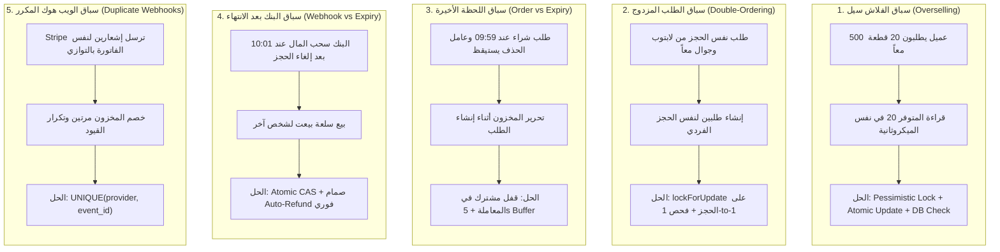
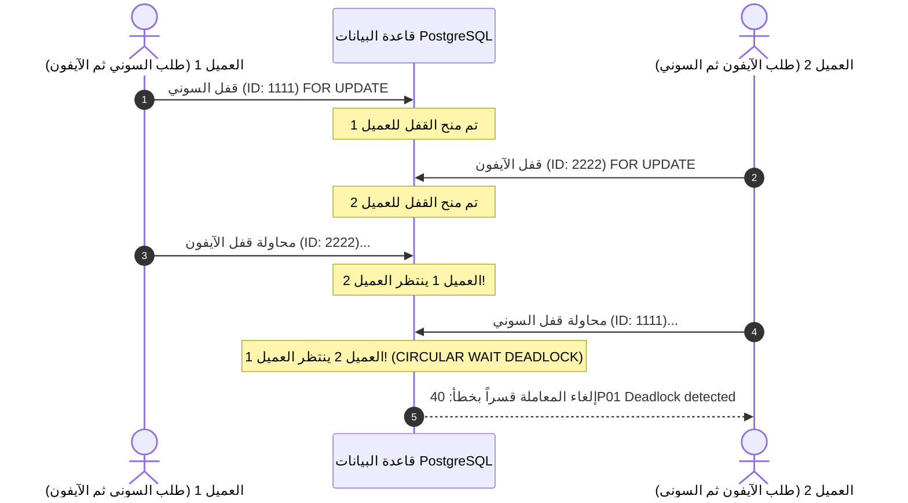

# الدليل الهندسي الشامل: مشاكل الـ Race Conditions والـ Deadlocks وحلولها في StockForge

> **مرجع تقني وهندسي لتوثيق كافة سيناريوهات التزامن، التسابق، والجمود في محرك المخزون عالي التزامن.**

---

## 1. المفاهيم الأساسية: الفرق بين Race Condition و Deadlock

| المصطلح | ما هو ببساطة؟ | متى يحدث في هذا المشروع؟ | النتيجة الكارثية لو لم يُحل |
| :--- | :--- | :--- | :--- |
| **Race Condition** <br/> *(تسابق العمليات)* | عندما تعتمد صحة البيانات على **"من يصل أولاً"** بين عمليتين تقرآن وتكتبان على نفس السجل بالتوازي. | 500 عميل يشترون 20 قطعة معاً، أو وصول تأكيد البنك في نفس ثانية إلغاء الحجز. | **بيع زائد (Overselling)**، رصيد مخزون سالب، أو تحرير بضاعة تم دفع قيمتها بالفعل. |
| **Deadlock** <br/> *(الجمود التام / الطريق المسدود)* | عندما تقفل العملية (1) المورد (A) وتنتظر المورد (B)، بينما تقفل العملية (2) المورد (B) وتنتظر المورد (A). | عميل يطلب (سوني ثم آيفون)، وعميل آخر يطلب (آيفون ثم سوني) في نفس اللحظة. | تجمد المعاملتين وانهيار الطلب بخطأ PostgreSQL: `40P01: deadlock detected`. |

---

## 2. مشاكل الـ Race Conditions الخمس في المشروع بالتفصيل



---

### المشكلة 1: سباق الفلاش سيل والبيع الزائد (Flash Sale Overselling)

#### أ) كيف يحدث؟
* المتوفر في المستودع: **20 قطعة PS5 Pro**.
* في تمام الساعة 12:00:00، يضغط **500 مستخدم** زر "حجز".
* خوادم الـ PHP المتعددة (Workers) تقرأ قاعدة البيانات في نفس الميكروثانية:
  * Worker 1 يقرأ: `available_quantity = 20`.
  * Worker 2 يقرأ: `available_quantity = 20`.
  * ... Worker 50 يقرأ: `available_quantity = 20`.
* جميع المعالجات ترى أن الـ 20 قطعة كافية، فيقوم كل معالج بخصم 1 وحجز القطعة.
* **الكارثة**: حجز 50 قطعة لبضاعة لا يوجد منها سوى 20، ويصبح المخزون سالباً (-30)!

#### ب) كيف حُل في المشروع؟ (منظومة دفاع ثلاثية)
1. **الاستراتيجية A: القفل التشاؤمي (`PessimisticLockReservationService`)**:
   نحجز السجل داخل قاعدة البيانات ونمنع أي قراءة أخرى حتى تنتهي المعاملة:
   ```php
   $stock = ProductWarehouse::where('id', $id)
       ->lockForUpdate() // قفل حصري على مستوى الصف (Row-level exclusive lock)
       ->first();
   
   if ($stock->available_quantity < $quantity) {
       throw new InsufficientStockException();
   }
   
   $stock->available_quantity -= $quantity;
   $stock->reserved_quantity += $quantity;
   $stock->save();
   ```
2. **الاستراتيجية B: التحديث الذري المشروط (`AtomicUpdateReservationService`)**:
   تنفيذ الخصم والشرط في استعلام SQL ذري واحد دون أقفال طويلة:
   ```sql
   UPDATE product_warehouses
   SET available_quantity = available_quantity - :qty,
       reserved_quantity = reserved_quantity + :qty,
       version = version + 1
   WHERE id = :id AND available_quantity >= :qty;
   ```
   * إذا أعاد الاستعلام `affected_rows == 1`: تم الحجز بنجاح.
   * إذا أعاد `0`: المخزون نفد، ويُرفض الطلب فوراً في جزء من الميلي ثانية دون أي انتظار أو ضغط على السيرفر.
3. **حائط الصد الأخير (Database Check Constraints)**:
   في ملف الميجريشن أضفنا قيداً على مستوى محرك PostgreSQL:
   ```sql
   ALTER TABLE product_warehouses ADD CONSTRAINT chk_available_non_negative CHECK (available_quantity >= 0);
   ```
   حتى لو فشل كود الـ PHP، سترفض قاعدة البيانات كتابة أي رقم سالب في القرص الصلب.

---

### المشكلة 2: سباق الطلب المزدوج (Double-Ordering Race)

#### أ) كيف يحدث؟
* العميل يملك حجزاً واحداً مدته 10 دقائق.
* لزيادة فرصته، فتح صفحة السلة من **تطبيق الجوال ومن متصفح الكمبيوتر** في نفس اللحظة، وضغط "إتمام الطلب" من الجهازين معاً.
* كل جهاز يُولّد مفتاح `Idempotency-Key` مختلف تماماً (UUID مختلف).
* إذا وصل الطلبان بالتوازي، سيجد كلا المعالجين أن الحجز نشط وليس له طلب سابق، فيتم إنشاء **طلبين وفاتورتين رسميتين لنفس الحجز الفردي!**

#### ب) كيف حُل في المشروع؟ (`OrderService.php` الأسطر 51-89)
1. استخدام القفل الحصري على سجل الحجز داخل المعاملة:
   ```php
   $reservation = Reservation::where('id', $data['reservation_id'])
       ->lockForUpdate()
       ->first();
   ```
2. فحص قاطع للربط الأحادي (1-to-1 Binding):
   ```php
   $existingOrder = Order::where('reservation_id', $reservation->id)->first();
   if ($existingOrder) {
       throw new InvalidReservationException('RESERVATION_ALREADY_ORDERED', 409);
   }
   ```
   المعالج الثاني ينتظر حتى تنتهي معاملة الأول، ثم يقرأ الحجز فيجد أن له طلباً مسجلاً بالفعل، فيُرفض بكود `409 Conflict`.

---

### المشكلة 3: سباق اللحظة الأخيرة (Order Creation vs. TTL Expiry Worker)

#### أ) كيف يحدث؟
* مدة الحجز 10 دقائق (من 12:00:00 إلى 12:10:00).
* عند الدقيقة **12:09:59** (قبل انتهاء المهلة بميكروثانية واحدة):
  * العميل يضغط على إتمام الطلب.
  * في نفس اللحظة استيقظ `ExpireReservationJob` في طابور Redis ليقوم بإلغاء الحجز وإعادة المخزون!
* **الكارثة**: لو لم يكن هناك تزامن محكوم، سيقوم الـ Job بإرجاع المخزون وبيعه لشخص آخر، بينما الـ `OrderService` ينشئ طلباً لنفس السلعة!

#### ب) كيف حُل في المشروع؟ (`ExpireReservationJob.php` و `OrderService.php`)
1. كلاهما يقفل الحجز داخل المعاملة بـ `lockForUpdate()`. أحدهما سيربح القفل أولاً:
   * إذا ربح `OrderService`: تتحول حالة الحجز، وعندما يدخل الـ Worker يجد أن الحالة لم تعد `ACTIVE` فيتراجع فوراً دون مساس بالمخزون.
   * إذا ربح الـ `Worker`: تتحول حالة الحجز إلى `EXPIRED`، فيرفض الـ `OrderService` إنشاء الطلب بأمان.
2. **هامش الأمان الزمني (TTL Jitter Buffer)**:
   ```php
   if ($reservation->expires_at && $reservation->expires_at->greaterThan(now()->addSeconds(5))) {
       return; // تخطي الإلغاء إذا كان هناك أي فارق ميلي ثانية بين توقيت الخوادم
   }
   ```

---

### المشكلة 4: سباق الدفع ضد انتهاء الصلاحية (The Fatal Payment vs. Expiry Race)

#### أ) كيف يحدث؟
* الحجز انتهى الساعة 12:10:00.
* تأخر العميل في استلام كود الـ OTP من البنك.
* عند الساعة **12:10:00**: قام الـ `ExpireReservationJob` بإلغاء الحجز وأعاد القطعة للرصيد المتاح، وقام شخص ثانٍ بحجزها فوراً!
* عند الساعة **12:10:01**: وصل إشعار Webhook من Stripe بسحب 800$ من بطاقة العميل الأول بنجاح!
* **الكارثة**: لو قبلنا الدفع وحولنا الطلب لـ `PAID`، نكون قد بعنا نفس القطعة لشخصين بعد استلام المال!

#### ب) كيف حُل في المشروع؟ (Atomic CAS + Auto-Refund Trigger)
1. قفل الحجز وفحص حالته ذرياً:
   ```php
   $reservation = Reservation::where('id', $order->reservation_id)->lockForUpdate()->first();
   
   if ($reservation->status === Reservation::STATUS_ACTIVE) {
       // الحالة السليمة: خصم المخزون وتأكيد الطلب
       $order->update(['status' => Order::STATUS_PAID]);
       $reservation->update(['status' => Reservation::STATUS_CONFIRMED]);
       $stockMovementService->recordSale(...); // نقل من reserved إلى sold
   } else {
       // سباق الدفع المتأخر: الحجز انتهى مسبقاً ومخزونه تحرر وبيِع لشخص آخر!
       // لا نلمس المخزون المتاح نهائياً (منع الـ Overselling تماماً)
       $order->update(['status' => Order::STATUS_EXPIRED]);
       
       // إطلاق الاسترداد التلقائي الفوري عبر Stripe
       $stripePaymentService->refundPayment($payment, reason: 'RESERVATION_EXPIRED_BEFORE_PAYMENT');
   }
   ```

---

### المشكلة 5: سباق الـ Webhook المكرر (Duplicate Webhooks Race)

#### أ) كيف يحدث؟
* عند حدوث بطء في شبكة الإنترنت لجزء من الثانية، تقوم Stripe بإرسال **نسختين متطابقتين من نفس إشعار الدفع بالتوازي**.
* المعالجان ينفذان الخصم في نفس اللحظة، مما قد يكرر تسجيل الحركات في دفتر الأستاذ أو يخصم المخزون مرتين.

#### ب) كيف حُل في المشروع؟
* جدول `payment_webhook_events` مع قيد فريد مركب:
  ```sql
  UNIQUE(provider, event_id)
  ```
* المعالج الأول يُسجل الحدث، والمعالج الثاني يصطدم فوراً بالقيد الفريد في قاعدة البيانات، فيتوقف فوراً ويعيد لـ Stripe رمز `200 OK` (معاملة تكرار آمنة Idempotent).

---

## 3. مشاكل الـ Deadlocks (الجمود التام) وكيف استأصلناها

### ما هو الـ Deadlock في بيئة المخازن المتعددة؟ (The Circular Wait Hazard)

تخيل سلة تسوق تحتوي على منتجين في مستودعين مختلفين:
* السلعة (1): جهاز PS5 في مستودع الرياض (`ID: 1111`).
* السلعة (2): جهاز iPhone في مستودع جدة (`ID: 2222`).



#### كيف ينهار النظام؟
* العميل 1 ماسك السوني ومستني الآيفون.
* العميل 2 ماسك الآيفون ومستني السوني.
* الطرفان متجمدان في انتظار بعضهما إلى الأبد!
* بعد ثوانٍ، يتدخل كاشف الجمود في PostgreSQL (`Deadlock Detector`) ويقوم بقتل إحدى المعاملتين قسراً ويرمي خطأ للمستخدم!

---

### كيف تم استئصال الـ Deadlocks برمجياً في المشروع؟

#### 1. الحل الجوهري: الترتيب الحتمي لمعرفات الأقفال (Deterministic ID Sorting)
القاعدة الرياضية لحل الجمود: **"إذا التزم الجميع بحجز الموارد بنفس الترتيب، فمن المستحيل رياضياً حدوث حلقة انتظار دائرية (Circular Wait)"**.

في كود `PessimisticLockReservationService.php`، نقوم بترتيب الـ IDs تصاعدياً قبل طلب القفل:

```php
// استخراج المعرفات وترتيبها أبجدياً/رقمياً بشكل حتمي
$sortedProductWarehouseIds = collect($items)
    ->pluck('product_warehouse_id')
    ->sort()
    ->values()
    ->all();

// طلب الأقفال بالترتيب التصاعدي دائماً
$locks = ProductWarehouse::whereIn('id', $sortedProductWarehouseIds)
    ->orderBy('id', 'asc') // مفتاح القضاء على الـ Deadlock!
    ->lockForUpdate()
    ->get();
```

* **النتيجة**:  
  كلا العميلين (1 و 2) سيحاولان قفل `ID: 1111` أولاً ثم `ID: 2222`.  
  الذي يصل أولاً سيقفل `1111`، والآخر سينتظر عند `1111` قبل أن يلمس `2222`!  
  **انكسرت الحلقة الدائرية بنسبة 100% واختفى الـ Deadlock تماماً!**

#### 2. الحل بالاستعلام الذري (Atomic Strategy B):
في استراتيجية الـ Atomic Update، لا نحجز أقفالاً ممتدة عبر عدة أسطر، بل ننفذ الاستعلام لكل صف وينتهي قفل السطر في أجزاء من الميكروثانية.

#### 3. آلية إعادة المحاولة عند الجمود (Deadlock Retries with Backoff):
في العمليات الحساسة، نستخدم خاصية إعادة المحاولة المدمجة في لارافيل:
```php
DB::transaction(function () {
    // كود المعاملة
}, 3); // إعادة المحاولة حتى 3 مرات مع تأخير عشوائي (Exponential Jitter) لو حدث قفل نادر
```

---

## 4. مصفوفة الملخص الشامل (Cheat Sheet)

| المعضلة | نوع التهديد | ما كان سيحدث بدون حماية | مكان الحل في الكود | التقنية المستخدمة |
| :--- | :--- | :--- | :--- | :--- |
| **Flash Sale Race** | Race Condition | رصيد مخزون سالب وبيع زائد | `ReservationService.php` | `lockForUpdate` + `Atomic Conditional Update` + `DB CHECK` |
| **Multi-Item Deadlock** | Deadlock | تجمد السيرفر وانهيار الطلبات | `PessimisticLockReservationService.php` | **Deterministic ID Sorting** (`orderBy('id', 'asc')`) |
| **Double-Ordering** | Race Condition | فاتورتان لنفس الحجز الفردي | `OrderService.php` | `Reservation lockForUpdate` + فحص الربط 1-to-1 |
| **Order vs Expiry** | Race Condition | بيع سلعة ألغيت في آخر ثانية | `OrderService` + `ExpireReservationJob` | قفل معاملة مشترك + `5s TTL Jitter Buffer` |
| **Webhook vs Expiry** | Race Condition | بيع قطعة مدفوعة لشخص ثانٍ | `StripeWebhookProcessor.php` | **Atomic CAS** + **Auto-Refund Trigger** |
| **Duplicate Webhook** | Race Condition | تكرار قيود البيع والدفعات | `payment_webhook_events` | `UNIQUE(provider, event_id)` في قاعدة البيانات |
